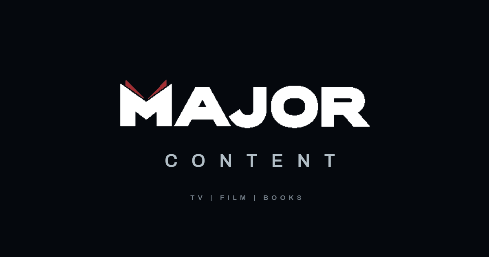

<div align="center">



### The website for MAJOR CONTENT

A TV, film and literary management company founded by Raymond Garcia.

[www.majorcontent.com](https://www.majorcontent.com)

[](https://nextjs.org)
[](https://react.dev)
[](https://www.typescriptlang.org)
[](https://tailwindcss.com)
[](https://www.netlify.com)

</div>

## Contents

- [About](#about)
- [Getting started](#getting-started)
- [Project structure](#project-structure)
- [Editing the site](#editing-the-site)
- [Build and deploy](#build-and-deploy)
- [Documentation](#documentation)
- [Rights](#rights)

## About

A one-page static site, plus Terms and Privacy pages. Copy leads every section, and the title row is the only imagery in the body of the page.

| Section | What it shows |
|---|---|
| **Banner** | The 42-second reel, in one cut for computers and one for phones |
| **Company** | What the company is and how it works |
| **Title row** | 30 titles (4 shows and 26 books) in a paged carousel. Pressing a title opens its write-up, and a show also plays its trailer |
| **TV \| FILM and BOOKS** | The two halves of the business, side by side |
| **Founder** | Portrait, bio and recognition |
| **Footer** | Terms, Privacy and the copyright line |

The navbar appears once the page starts to scroll, and its Contact button carries the email address.

## Getting started

You'll need [Node.js](https://nodejs.org) 18.18 or newer. Python 3 is only needed to build the deployable site. The first build also needs internet access, because it downloads the Poppins font from Google Fonts.

```bash
git clone https://github.com/MajorTvStuff/frontend.git
cd frontend/site
npm install
npm run dev
```

The site runs at [http://localhost:3011](http://localhost:3011).

| Command (from `site/`) | What it does |
|---|---|
| `npm run dev` | Starts the dev server on port 3011 |
| `npm run build` | Makes a production build |
| `npm start` | Serves that production build on port 3011 |
| `npx tsc --noEmit` | Checks types |
| `python scripts/export-static.py` | Builds the deployable site and its zip |

There is no automated test suite.

## Project structure

```text
.
├── site/                  The website, and the only part of the repo that runs
│   ├── app/               Home, Terms and Privacy pages, robots, sitemap, global CSS
│   ├── components/        Page sections and UI (HeroBanner, Band, BookPanel, TopBar)
│   ├── content/           Site copy and title data, as JSON
│   ├── fonts/             Self-hosted Archivo
│   ├── lib/               Content loading and validation, browser helpers
│   ├── public/            Reel, book and show art, founder portrait, redirects
│   ├── scripts/           Build and packaging scripts
│   └── preview-site.cmd   Serves the built site on Windows
├── docs/                  Creative direction, roadmap and review documents
└── archive/               Earlier builds, kept for reference. Nothing here runs.
```

`Assets/` (the client's original files) and `deploy/` (the built zips) are git-ignored, so a fresh clone won't have them. The export script creates `deploy/` when it runs.

`Hero`, `Slate` and `Shelf` in `components/`, along with `lib/clump.ts` and `lib/stage.ts`, are parked and not on the page. `BookPanel.tsx` still imports the `Cover` type from `Shelf.tsx`, so move that type before deleting `Shelf.tsx`.

## Editing the site

Everything the page says comes from `site/content/`.

| To change | Edit |
|---|---|
| Company, TV \| FILM, BOOKS and founder copy | `site/content/site.json` |
| Contact email and legal entity | `site/content/site.json` |
| Which titles appear, in what order, with their credits, proof lines and trailers | `site/content/projects.json` |
| The write-up shown when a title is pressed | `site/content/research.json` |
| Terms and Privacy | `site/app/terms/page.tsx` and `site/app/privacy/page.tsx` |

> [!IMPORTANT]
> `site.json` and `projects.json` hold the client's approved copy, word for word. Don't reword anything in them without his sign-off.
>
> `research.json` is ours, written from published sources that are cited in each entry. His role on a title is never guessed, and publication dates stay off the page.

### Adding a title

1. Save the cover or key art as `site/public/projects/<slug>.jpg`.
2. Add its pixel size to `site/lib/image-dims.json`. The build fails without it.
3. Add the title to `site/content/projects.json`. Its position in the file is its position in the row.
4. Add its write-up to `titles` in `site/content/research.json`, with `onSite` set to `true`.
5. Books stack in pairs by default. To make one full height, add its slug to `STAND_ALONE` in `site/components/Band.tsx`.

### Replacing the reel

1. Replace that cut's three files in `site/public/brand/`: `major-content-reel-<cut>.webm`, `.mp4` and `-end.webp`, a still of its last frame. `<cut>` is `final` (computers, 1080p) or `mobile` (phones, 720p).
2. Move that cut's date on in `REEL` in `site/components/HeroBanner.tsx`. The date is part of each video's URL, so browsers and CDNs can't keep serving the old file.
3. If the background of the footage has changed, re-sample `.hero-film-ground` in `site/app/globals.css` so the banner still blends into the film's edges.

<details>
<summary>Encoding settings</summary>

For the final cut:

```bash
# H.264 for Safari
ffmpeg -i master.mp4 -vf "scale=-2:1080:flags=lanczos" \
  -c:v libx264 -preset slow -crf 25 -g 150 -x264-params aq-mode=3 -pix_fmt yuv420p \
  -c:a aac -b:a 128k -movflags +faststart major-content-reel-final.mp4

# VP9 for other browsers, in two passes
ffmpeg -y -i master.mp4 -vf "scale=-2:1080:flags=lanczos" \
  -c:v libvpx-vp9 -b:v 0 -crf 32 -row-mt 1 -cpu-used 2 -auto-alt-ref 1 -lag-in-frames 25 \
  -pass 1 -an -f null -

ffmpeg -i master.mp4 -vf "scale=-2:1080:flags=lanczos" \
  -c:v libvpx-vp9 -b:v 0 -crf 32 -row-mt 1 -cpu-used 2 -auto-alt-ref 1 -lag-in-frames 25 \
  -pass 2 -c:a libopus -b:a 112k major-content-reel-final.webm
```

For the mobile cut, use `scale=-2:720` and `-crf 33` for VP9. The H.264 settings stay the same.

Check the end of each new cut. The banner rests on the film's last frame, so a black last frame needs trimming.

</details>

## Build and deploy

Always deploy through the export script. A plain `npm run build` leaves the amber "confirm with client" review chips switched on.

```bash
cd site
python scripts/export-static.py
```

This writes the finished site to `site/out/` and zips it to `deploy/majorcontent-static.zip`.

**To preview it,** double-click `site/preview-site.cmd` on Windows, or run this from `site/`:

```bash
npx http-server@14 out -p 3013
```

> [!WARNING]
> Don't open `out/index.html` directly. Every path in it starts at the site's root, so nothing loads from disk. It has to be served.

**To deploy it,** drag the zip onto the Deploys page of the Netlify site. `site/public/_redirects` and `site/public/netlify.toml` forward majortvproductions.com to www.majorcontent.com.

The zip also works on plain file hosting: extract it inside cPanel's `public_html`. It deliberately has no `.htaccess`, so it won't overwrite cPanel's own rules. `scripts/package-deploy.py` is the older route, which packages the site as a Node.js app for cPanel.

<details>
<summary>Environment variables</summary>

The scripts set these for you. Everyday development needs none of them.

| Variable | Effect |
|---|---|
| `NEXT_OUTPUT` | `export` builds plain files. `standalone` builds a self-contained Node server. |
| `NEXT_PUBLIC_SHOW_TODOS` | `false` hides the amber review chips, which show by default. |
| `NEXT_DIST_DIR` | Overrides the build output directory. |
| `NEXT_IMAGES_UNOPTIMIZED` | `1` turns off Next's image optimizer. |

</details>

## Documentation

| Document | What it covers |
|---|---|
| [Creative direction](docs/RG-CREATIVE-DIRECTION.md) | The client's own words, decoded into build decisions |
| [Concepts](docs/MAJOR-CONTENT-CONCEPTS.md) | The original three directions and the questions put to the client |
| [Roadmap](docs/ROADMAP.md) | Work that's agreed but not built, and what's blocked on the client |
| [Synopses for review](docs/SYNOPSES-FOR-REVIEW.md) | The title write-ups, compiled for sign-off |

## Rights

This repository has no open-source license. The copy, artwork and footage belong to Major TV, Inc. and their respective rights holders, including the publishers and networks of the titles shown.
